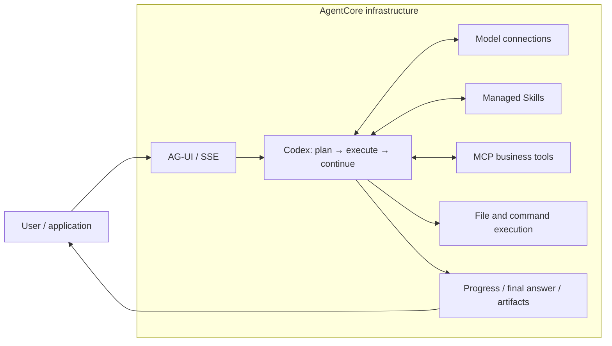

# AgentCore Runloop

[简体中文](README.md) | English

> **An extensible Agent runtime framework, currently built on Codex and AgentCore.**
> Skills · MCP tools · File and command execution · Streaming · Artifact delivery

## Overview

**Run Codex on AgentCore infrastructure, connecting task planning, tool execution and result delivery in one Agent service.**

Codex plans tasks, calls tools and continues based on execution results. AgentCore provides model connections, managed Skills, MCP resources and runtime infrastructure. This project connects them and exposes progress, tool events and final answers through AG-UI / SSE, with support for delivering generated files.

This project targets AgentCore’s custom code / image deployment mode, with a container build and deployment guides. Combine model connections, Skills, MCP tools and execution backends for analysis, office workflows, development and knowledge services. Business requirements become reusable Skills, connectors and runtime capabilities. Codex is currently the only supported execution engine.

[Deploy on AgentCore](docs/agentcore-guide.en.md) · [Application scenarios](#application-scenarios) · [Configuration reference](docs/reference.md)



## Capabilities

| Capability | What it enables | Configuration / interface |
| --- | --- | --- |
| Model connections | Drive the Codex execution loop through an AgentCore model connection | `AGENTCORE_MODEL_CONNECTION`, `AGENTCORE_MODEL_NAME` |
| Skills | Load managed Skills and their scripts; pin versions with `name@version` | `AGENTCORE_SKILLS` |
| MCP | Discover and call bound business tools; report a warning and skip an MCP whose discovery fails | `AGENTCORE_MCP_SERVERS` |
| File and command execution | Choose local execution, a remote sandbox, or tools-only operation at deployment | `AGENTCORE_EXECUTION` |
| Attachments and artifacts | Process confirmed attachments and publish generated files as `/f/<file-id>` references | Attachment protocol and `publish_artifact`; requires storage and a file-serving application |
| Streaming and human input | Stream execution activity, tool events and final answers; support client tools and approval resumption | `/ag-ui/agent` |

### Execution modes

| Mode | Where file / shell operations run | Use |
| --- | --- | --- |
| `local` (default) | In the Agent container, constrained by the native Codex OS sandbox | Work with files and scripts; the runtime must pass isolation preflight |
| `sandbox` | In Agent Sandbox through MCP | Run file and command operations remotely; failures never fall back to local execution |
| `tools-only` | Local file and shell execution is disabled | Complete tasks using the model and bound MCP tools |

Execution mode is deployment configuration and cannot be overridden by individual requests. See the [isolation and configuration reference (Chinese)](docs/reference.md#执行隔离local--sandbox).

## Application scenarios

These are ways to combine the available capabilities, **not verified customer case studies**.

| Scenario | Agent workflow | Expected deliverable |
| --- | --- | --- |
| Operational data analysis | Read an uploaded CSV → run calculations → summarize findings → publish files | Markdown report and result CSV |
| Enterprise knowledge and business queries | Query systems through MCP → apply rules from a Skill → explain the evidence | Answers with sources and structured results |
| Document and code processing | Read workspace material → execute a Skill's checks or transformations → request approval when needed → deliver results | Review reports or transformed files |
| Remote sandbox execution | Acquire a conversation sandbox on demand → import Skills and attachments → run file/shell operations → publish results | Execution results and artifacts; the E2B SDK connects to Alibaba Cloud Agent Sandbox |
| Enterprise Skill assistants | Bind versioned Skills → prepare rules, scripts and templates → combine them with MCP tools | Reusable domain workflows with traceable Skill versions |

For example, an operational analysis workflow could start with “Analyze this sales CSV, identify anomalies and generate a report.” Codex would read the attachment, run analysis scripts and deliver the report through `publish_artifact`. The application needs attachment storage and a file-serving service; business rules can live in Skills, and data queries can use MCP tools.

In sandbox mode, orchestration and model calls stay in the service container while file and shell operations run remotely. See the [scenario recipes and architecture (Chinese)](docs/scenarios/README.md) and [capability catalog (Chinese)](docs/scenarios/capabilities.md) for existing implementation, integration work and extension boundaries. These workflows still require end-to-end validation in the target environment.

## Performance

In a sequential short-answer retest on a 4 vCPU / 8 GiB deployment, five successful samples had a first-text P50 of **1.33 s** and completion P50 of **1.92 s**. The sixth request returned HTTP 429 and stopped the run. First text includes activity text and is not model-server TTFT; this is not a stable performance baseline. See [conditions, latency and failures](docs/performance.en.md).

## Quick start

**Deploy to AgentCore:** follow [Using this project on AgentCore](docs/agentcore-guide.en.md) to build the image, configure the service and run your first conversation. The guide also explains the requirements for code-package deployment.

**Explore locally:** install Node.js 22+ and Codex CLI, then run from the repository root:

```sh
npm ci
npm run dev:mock
```

Send a sample request from another terminal:

```sh
curl -N http://127.0.0.1:8080/ag-ui/agent \
  -H 'Content-Type: application/json' \
  --data-binary @examples/ag-ui.json
```

Mock mode uses simulated AgentCore resources with a real Codex CLI and listens on `127.0.0.1:8080` by default. It demonstrates interfaces and events rather than real cloud inference. If a local `.env` exists, clear optional resource settings and supply any configured authentication header.

Customize behavior with `AGENTCORE_SYSTEM_PROMPT` and extend request handling in `src/app.ts`. See [.env.example](.env.example) for configuration; keep credentials and platform identity files out of source and images.

## Documentation and development

- [Scenario recipes (Chinese)](docs/scenarios/README.md): reusable workflows, architecture and acceptance criteria.
- [Capability catalog (Chinese)](docs/scenarios/capabilities.md): implementation evidence and extension boundaries.
- [Using this project on AgentCore](docs/agentcore-guide.en.md): preparation, deployment, verification and troubleshooting.
- [中文部署教程](docs/agentcore-guide.md): Chinese deployment guide.
- [Configuration and implementation reference (Chinese)](docs/reference.md): full API, environment, attachment, artifact and observability details.
- [Official AgentCore deployment guide](https://help.aliyun.com/en/agentcore/high-code-agent-deployment-guide): platform requirements and console operations.

```sh
npm run verify
npm run test:upstream
```

`src/main.ts` starts the service, `src/app.ts` connects requests to the Agent loop, `src/runtime.ts` wraps the AgentCore SDK, and `vendor/runloop/` provides the Codex adapter and execution core. This package supports Codex only; other CLI adapters and legacy AgentRun integrations are excluded.

The image installs the official `@openai/codex` package and invokes it as a subprocess; this repository does not vendor Codex itself. Codex uses [Apache-2.0](https://github.com/openai/codex/blob/main/LICENSE); retain its license and applicable notices when distributing images.
