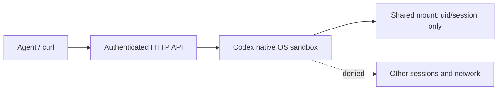

# AgentCore Sandbox service

This branch starts a **pure Sandbox HTTP service**, without a model, Agent loop,
AgentCore resource discovery, STS broker, or remote sandbox dependency. Historical
Agent code remains in the repository for reference; it is not mounted by this entrypoint.
The previous deployment documentation is archived in [agent-mode-reference](docs/agent-mode-reference.md).

## Isolation



Each deployed instance is bound to one deployment-configured user and session.
Every command AND file operation runs through `codex sandbox`, using the existing
native permissions-profile builder with **only the session directory writable**.
Minimal system/runtime reads are granted; the shared mount, parent user directory,
control home, and arbitrary host paths are not granted. Network is disabled.
Environment variables are explicitly allowlisted, with no platform credential inheritance.
The CLI configuration home is separate from the writable session. Preflight failure
returns 503; there is no unrestricted execution fallback.

The container runs as `coder`, not root. Mount ownership must allow that user to
create `<AGENTCORE_WORKDIR>/<uid>/<session>`. Reserve these parent directories for
this service: other privileged writers must not rename/replace them during use.
Use a dedicated data mount outside system/runtime directories. Do not mount secrets
inside runtime-readable directories or the session directory. Native filesystem/network
sandboxing is not a substitute for container isolation, memory/CPU/PID limits, or
platform identity protection. Separate service instances remain the isolation boundary
for mutually untrusted processes. Shared storage alone does not imply shared processes.

Codex 0.155.0 is pinned in the image. Linux must permit its native sandbox backend;
restricted container environments may reject it. Run `npm run smoke:native-service`
on the **target Linux image, mount and runtime policy** before deployment. A successful
macOS test is not proof of Linux enforcement. Do not enable privileged mode as a fallback.

## Configuration and startup

Copy `.env.example` to a private `.env` and supply:

| Variable | Meaning |
| --- | --- |
| `AGENTCORE_WORKDIR` | Required absolute shared-storage root |
| `AGENTCORE_SANDBOX_UID` | Required deployment-bound user ID |
| `AGENTCORE_SANDBOX_SESSION_ID` | Required deployment-bound session ID |
| `AGENTCORE_RUNLOOP_API_TOKEN` | Required random secret of at least 32 characters |
| `AGENTCORE_HOST` | Listen address, default `127.0.0.1`; image uses `0.0.0.0` |
| `AGENTCORE_PORT` | Port, default `8080` |
| `AGENTCORE_SANDBOX_CLI` | Trusted Codex executable, default `codex` |

IDs allow letters, digits, `_` and `-`, up to 128 characters. These values are deployment
configuration, not client request fields. Clients of an instance share its session authority.
Use TLS and authenticated platform routing for exposed deployments.

```sh
npm ci
npm run build
npm start
```

The listener starts independently of storage; `/readyz` prepares the session and runs
native sandbox preflight. Failures can be retried after fixing mount/runtime permissions.
`/healthz` reports process liveness. Neither endpoint exposes paths or credentials.

## HTTP API

All `/v1/*` endpoints require `Authorization: Bearer <token>`.
Examples assume `SANDBOX_URL` and `SANDBOX_TOKEN` are set in the caller's shell.

```sh
curl "$SANDBOX_URL/v1/exec" \
  -H "Authorization: Bearer $SANDBOX_TOKEN" \
  -H 'Content-Type: application/json' \
  -d '{"command":"/bin/bash","args":["-lc","printf hello > result.txt; cat result.txt"],"timeoutMs":30000}'

curl -X PUT "$SANDBOX_URL/v1/files?path=input.bin" \
  -H "Authorization: Bearer $SANDBOX_TOKEN" --data-binary @input.bin

curl "$SANDBOX_URL/v1/files?path=result.txt" \
  -H "Authorization: Bearer $SANDBOX_TOKEN" --output result.txt

curl "$SANDBOX_URL/v1/directories?path=." \
  -H "Authorization: Bearer $SANDBOX_TOKEN"
```

- `POST /v1/exec`: synchronous command + args, optional timeout (1–60000 ms,
  default 30000). Returns `stdout`, `stderr`, nullable `exitCode`, `timedOut`,
  `truncated`. A nonzero command exit is an execution result, not an HTTP error.
  Combined output is limited to 1 MiB; overflow terminates the process group.
- `GET /v1/files`: binary download, maximum 8 MiB; relative `path` is required.
- `PUT /v1/files`: binary upload, maximum 8 MiB; create-only, existing targets rejected.
  Parent directories must exist (create via an exec command).
- `GET /v1/directories`: list relative directory, default `.`, maximum 10000 entries
  and 1 MiB serialized output.
- File APIs reject absolute paths, traversal and symlinks, and use the native OS sandbox
  as the final filesystem enforcement boundary. File failures return a generic 422.
- One operation at a time per instance; concurrent operations receive 409. Invalid
  input returns 400, missing/wrong token 401, oversized bodies 413, executor failures 503.
- Shell cwd is fixed to the session root; use an explicit shell command to `cd` within it.
  Request-supplied environment, session identity and permission overrides are rejected.
- HTTP disconnection does not cancel execution; the configured deadline still applies.
  No automatic retries, persistent jobs, PTY, streaming, E2B SDK compatibility or
  cross-restart execution recovery are claimed in this first version. Commands should
  remain foreground jobs; detached daemons are unsupported. Platform PID limits and
  instance teardown remain necessary for malicious processes that detach themselves.
- Output is returned to the authenticated caller, not logged. Host execution failures
  are sanitized. Files persist according to the mounted storage's lifecycle.

## Verification

```sh
npm run typecheck
npm run test:coverage
npm run build
npm run smoke:native-service
```

Unit tests cover HTTP contracts and fail-closed paths. The native smoke test separately
checks allowed operations, cross-session reads/writes, symlink escape and local network
denial using real Codex; it does not call any model or cloud service.

## Linux shared-storage verification

A real Linux arm64 Podman test on 2026-10-27 passed 38 checkpoints using two
non-root, non-privileged service containers mounting the same volume at `/shared`.
Each instance was bound to `alice/a` or `alice/b`. A direct container diagnostic
could read the sibling sentinel, while the service's sandboxed commands could not.
Normal execution, binary upload/download and directory listing succeeded. Both
sessions were denied sibling reads, overwrites and creates via absolute paths,
parent traversal and symlink escapes. Sentinels remained unchanged.

**Environment prerequisite:** default SELinux container labeling blocked bubblewrap's
nested devpts mount; `/readyz` returned 503. The successful test used
`--security-opt label=disable` only on the disposable service containers. Default
seccomp, non-root execution and the full Codex filesystem/network policy remained
in force. This is a disclosed test configuration, not an automatic service fallback.
Production needs a compatible container/SELinux policy; this does not establish
that an arbitrary default Docker/Kubernetes deployment will work.

```sh
podman build --format docker -t localhost/agentcore-sandbox:session-proof .
PODMAN_CONNECTION=podman-machine-default-root \
AGENTCORE_TEST_DISABLE_SELINUX_LABEL=1 \
npm run verify:linux-sessions -- localhost/agentcore-sandbox:session-proof
```

Omit the test flag to test the default container label policy. The script creates
randomly named containers and a disposable shared volume, generates temporary
authentication secrets without printing them, and removes its containers, volume
and credential files in `finally`. It never enables privileged mode. The optional
`AGENTCORE_TEST_DIAGNOSTICS=1` prints results of fixed, nonsensitive probe commands.
These are test-harness variables, not service deployment settings.

Linux testing also exposed a Node stream-output regression on inherited socketpairs
under network denial. A fixed trusted Bash transport now gives sandboxed commands
real stdout/stderr pipes, preserves positional arguments and exit status, and waits
for output to drain. Requested programs still execute through Codex; the transport
never evaluates caller-supplied command text. The Linux HTTP binary roundtrip and
Node stdout assertions reproduce and cover the original failure.

See [verification evidence](docs/pure-sandbox-verification.md) for versions and limits.
