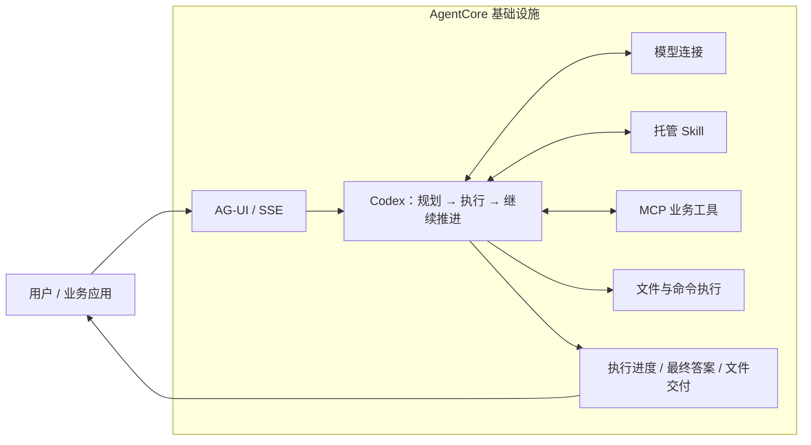

# AgentCore Runloop

简体中文 | [English](README.en.md)

> **可扩展的通用 Agent 运行时框架，当前基于 Codex 与 AgentCore。**
> 技能 · MCP 工具 · 文件与命令执行 · 流式交互 · 结果交付

## 概要

**在 AgentCore 基础设施上运行 Codex，把任务理解、工具执行和结果交付接成一个完整的 Agent 服务。**

Codex 负责规划任务、调用工具并根据执行结果继续工作；AgentCore 提供模型连接、托管 Skill、MCP 资源和运行基础设施。本项目将两者连接起来，通过 AG-UI / SSE 向控制台或业务应用输出执行进度与最终答案，并支持交付生成的文件。

项目面向 AgentCore 自定义代码 / 镜像模式，提供镜像构建和部署教程。通过组合模型连接、Skill、MCP 与执行后端，可以覆盖分析、办公、研发和知识服务等场景。业务需求优先沉淀为可复用的技能、工具连接器和运行时能力；当前执行内核仅支持 Codex。

[开始部署](docs/agentcore-guide.md) · [场景方案](docs/scenarios/README.md) · [通用能力目录](docs/scenarios/capabilities.md) · [完整配置](docs/reference.md)



## 支持的能力

| 能力 | 可以做什么 | 配置 / 接口 |
| --- | --- | --- |
| 模型连接 | 通过 AgentCore 模型连接驱动 Codex 执行循环 | `AGENTCORE_MODEL_CONNECTION`、`AGENTCORE_MODEL_NAME` |
| Skill | 加载托管技能与附带脚本，支持 `name@version` 固定版本 | `AGENTCORE_SKILLS` |
| MCP | 发现并调用绑定的业务工具；单个 MCP 发现失败时上报 warning 并跳过 | `AGENTCORE_MCP_SERVERS` |
| 文件与命令执行 | 按部署选择本地执行、远端沙箱或仅工具模式 | `AGENTCORE_EXECUTION` |
| 附件与文件交付 | 处理已确认的附件，将生成文件发布为可供应用访问的 `/f/<file-id>` 引用 | 附件协议、`publish_artifact`；需配置存储与文件访问服务 |
| 流式交互与人工确认 | 输出执行活动、工具事件和最终答案，支持客户端工具与审批恢复 | `/ag-ui/agent` |

### 执行模式

| 模式 | 文件 / Shell 在哪里执行 | 适用方式 |
| --- | --- | --- |
| `local`（默认） | Agent 容器内，受 Codex 原生 OS 沙箱约束 | 需要读写工作目录、运行脚本；须通过运行环境隔离预检 |
| `sandbox` | 通过 MCP 转发到 Agent Sandbox | 文件与命令放在远端沙箱；失败不会回退到本地 |
| `tools-only` | 关闭本地文件与 Shell 执行 | 以模型和已绑定 MCP 工具完成任务 |

执行模式是部署配置，不接受单次请求覆盖。[隔离边界与配置说明](docs/reference.md#执行隔离local--sandbox)。

## 应用场景

以下是可以组合现有能力实现的场景，**不是已经验证的客户落地案例**。

| 场景 | Agent 工作流程 | 预期交付 |
| --- | --- | --- |
| 运营数据分析 | 读取已上传的 CSV → 运行计算脚本 → 汇总异常和结论 → 发布文件 | Markdown 报告、结果 CSV |
| 企业知识与业务查询 | 通过 MCP 查询业务系统 → 使用 Skill 中的规则处理结果 → 向用户说明依据 | 带来源的回答、结构化结果 |
| 文档与代码处理 | 读取工作区材料 → 按 Skill 执行检查或转换 → 必要时请求确认 → 交付结果 | 检查报告、转换后的文件 |
| 远程沙箱执行 | 按需创建会话工具沙箱 → 导入 Skill/附件 → 执行文件与 Shell 操作 → 发布结果 | 执行结果、代码与分析产物；使用 E2B SDK 对接阿里云 Agent Sandbox |
| 企业 Skill 专业助手 | 绑定固定版本 Skill → 装配规则、脚本与模板 → 结合 MCP 完成领域任务 | 可复用、可追溯版本的业务处理流程 |

例如，运营分析场景可以从“分析这份销售 CSV，找出异常并生成报告”开始，由 Codex 读取附件、调用分析脚本，再通过 `publish_artifact` 交付报告。接入应用需要配置附件存储和文件访问服务；业务规则可以封装为 Skill，数据查询可以接入 MCP。需要独立工具环境时选择 `sandbox`：编排与模型调用仍在服务容器，文件和命令由远端沙箱执行。

完整方案见[场景配方与架构](docs/scenarios/README.md)和[通用能力目录](docs/scenarios/capabilities.md)，涵盖现有实现、组合接入与扩展边界。上述业务流程仍需在目标环境端到端验证。

## 性能

4C8G 部署的串行短回答复测中，5 个成功样本的首文本 P50 为 **1.33 秒**，完成 P50 为 **1.92 秒**；第 6 次请求返回 HTTP 429 后停止。首文本包含活动文本，不等于模型服务端首 Token；本轮不作为稳定性能基线。[测试条件、完整时延与失败记录](docs/performance.md)。

## 快速使用

**部署到 AgentCore：**阅读[在 AgentCore 上使用](docs/agentcore-guide.md)，完成镜像构建、平台配置和首次对话。教程也说明了代码包部署需要准备的内容。

**本地查看接口：**准备 Node.js 22+ 和 Codex CLI 后，在项目根目录执行：

```sh
npm ci
npm run dev:mock
```

在另一个终端发送示例请求：

```sh
curl -N http://127.0.0.1:8080/ag-ui/agent \
  -H 'Content-Type: application/json' \
  --data-binary @examples/ag-ui.json
```

本地 mock 使用模拟的 AgentCore 资源和真实 Codex CLI，默认在 `127.0.0.1:8080` 监听；它用于体验接口和事件，不代表真实云端模型调用。若已有 `.env`，请使用空的可选资源配置，并按配置补充鉴权请求头。

通过 `AGENTCORE_SYSTEM_PROMPT` 调整行为，在 `src/app.ts` 扩展请求处理。完整配置见 [.env.example](.env.example)；凭证与平台身份文件不得进入源码或镜像。

## 文档与开发

- [场景方案](docs/scenarios/README.md)：业务需求、通用能力、场景组合与验收。
- [通用能力目录](docs/scenarios/capabilities.md)：当前实现、源码入口和扩展边界。
- [在 AgentCore 上使用](docs/agentcore-guide.md)：准备、部署、调试与排错。
- [English deployment guide](docs/agentcore-guide.en.md)：英文使用路径。
- [配置与实现参考](docs/reference.md)：接口、环境变量、附件、文件交付、观测和高级配置。
- [AgentCore 官方部署指南](https://help.aliyun.com/zh/agentcore/high-code-agent-deployment-guide)：平台部署要求与控制台操作。

```sh
npm run verify
npm run test:upstream
```

`src/main.ts` 是启动入口，`src/app.ts` 连接请求与 Agent 循环，`src/runtime.ts` 封装 AgentCore SDK，`vendor/runloop/` 提供 Codex 适配与执行内核。当前仅支持 Codex，不包含其他 CLI 或旧 AgentRun 平台集成。

Codex 由镜像安装官方 `@openai/codex` 包，并通过子进程调用；本仓库不包含 Codex 本体源码。Codex 的许可证见 [Apache-2.0](https://github.com/openai/codex/blob/main/LICENSE)，分发镜像时须保留其许可证和适用的声明。
