# AgentCore Runloop

`agentcore-runloop` 以 Node.js Harness 和 Codex 等 Agent CLI 作为执行引擎，对外提供 Runloop HTTP/SSE 与 AG-UI 接口。生产通过 `alibabacloud-agentcore-sdk` Node SDK 访问 AgentCore 模型、MCP 和 Skill。

## 架构

下面以一次用户请求为主线，展示公共准备、三种执行模式、Agent 工具循环、产物发布和请求清理：

```mermaid
flowchart TB
    Start(["用户发起任务"]) --> Entry["① 请求进入 AgentCore Runloop<br/>/v1/run · /ag-ui/agent · /invocations"]
    Entry --> Auth{"② API 访问鉴权通过？"}
    Auth -->|否| Unauthorized["返回 401 Unauthorized"]
    Auth -->|是| Parse["③ 校验 UID · ConversationId · RunId<br/>消息 · 附件 · Agent 参数"]
    Parse --> Valid{"请求是否合法？"}
    Valid -->|否| BadRequest["返回 400 INVALID_REQUEST"]
    Valid -->|是| Busy{"④ Conversation 是否已有任务？"}
    Busy -->|是| Conflict["返回 409 THREAD_BUSY"]
    Busy -->|否| Manifest["⑤ 锁定会话并获取 Manifest<br/>Model · MCP · Skill"]
    Manifest --> Ready{"核心资源可用？"}
    Ready -->|否| ResourceError["返回 503 RESOURCES_NOT_READY"]
    Ready -->|是| Mode{"⑥ AGENTCORE_EXECUTION"}

    Mode -->|local| Local["⑦-L 准备 Local 上下文<br/>cwd = WORKDIR/UID/ConversationId<br/>Skill 投影到内部 Workspace"]
    Mode -->|sandbox| Sandbox["⑦-S 注入 LazySandboxExecution<br/>逻辑 cwd = SANDBOX_ROOT<br/>此时不取 Key、不创建沙箱"]
    Mode -->|tools-only| Tools["⑦-T 仅允许 Codex<br/>不注入本地 cwd、文件或 Shell<br/>Skill 通过 AgentCore 工具读取"]

    Local --> Attachment{"包含附件？"}
    Sandbox --> Attachment
    Tools --> Attachment
    Attachment -->|是| Materialize["校验票据 · ETag · 大小<br/>物化到当前执行根 uploads/<br/>Sandbox 模式先 acquire 再写入"]
    Attachment -->|否| Build
    Materialize --> Build["⑧ 构建系统提示词与 RunRequest<br/>注入 Model Proxy · MCP · Skill 指引<br/>固定 UID/Conversation 身份头"]

    Build --> Runner["⑨ LoopRunner 启动 Codex"]
    Runner --> Preflight{"local 沙箱预检通过？"}
    Preflight -->|失败| LocalError["LOCAL_SANDBOX_UNAVAILABLE<br/>终止，不放宽权限"]
    Preflight -->|通过或非 local| Think["⑩ Agent 调用模型并规划任务"]
    Think --> ModelProxy["/model/v1 · 随机内部 Token"]
    ModelProxy --> Model["AgentCore Model"]
    Model --> Action{"⑪ Agent 下一步动作"}

    Action -->|直接回复| Output
    Action -->|业务 MCP| Mcp["/mcp → AgentCore 托管 MCP"]
    Mcp --> ToolResult["工具结果返回 Agent"]

    Action -->|文件 · Shell · Skill 文件| ExecMode{"⑫ 当前执行模式"}
    ExecMode -->|local| LocalExec["Codex 原生 OS 沙箱<br/>用户目录读写 · Skill 只读 · 命令禁网"]
    LocalExec --> ToolResult
    ExecMode -->|tools-only| ManagedOnly["仅调用已配置的托管 MCP<br/>框架不访问容器文件系统"]
    ManagedOnly --> ToolResult
    ExecMode -->|sandbox| Acquire["SandboxManager.acquire<br/>绑定键 = UID + ConversationId"]
    Sandbox -. "附件存在时提前触发 acquire" .-> Acquire

    Acquire --> Existing{"已有健康会话 Sandbox？"}
    Existing -->|是| Reuse["复用并按需续期"]
    Existing -->|否| Key{"解析 Sandbox Key"}
    Key -->|环境变量存在| DirectKey["AGENTCORE_SANDBOX_API_KEY"]
    Key -->|环境变量不存在| Credential["AgentCore.credentials.get<br/>资源名 = SANDBOX_CREDENTIAL"]
    DirectKey --> Volume
    Credential --> Volume{"配置 Volume？"}
    Volume -->|是| Metadata["运行时 STS 查询 Volume<br/>解析 Role 与网络 metadata"]
    Volume -->|否| Create["Sandbox.create"]
    Metadata --> Create
    Create --> CreateResult{"创建成功？"}
    CreateResult -->|是| Root["准备 SANDBOX_ROOT<br/>保存会话绑定"]
    CreateResult -->|失败或超时| SandboxError["脱敏 SANDBOX_NOT_READY"]
    SandboxError --> ToolResult

    Root --> SkillReady
    Reuse --> SkillReady{"Skill 版本集合已导入？"}
    SkillReady -->|否| Bundle["从 SDK 系统缓存构建 Bundle<br/>按 256 文件或 16 MiB 分片批量写入"]
    Bundle --> Marker["全部成功后写 ready marker"]
    Marker --> RemoteExec
    SkillReady -->|是| RemoteExec["Agent Sandbox Filesystem API<br/>与 commands.run"]
    RemoteExec -->|文件或 Shell 结果| ToolResult

    Action -->|发布最终文件| PublishMode{"⑬ 当前执行模式"}
    PublishMode -->|local| PublishLocal["从本地会话 cwd 读取"]
    PublishMode -->|sandbox| PublishSandbox["从会话 Sandbox 读取"]
    PublishMode -->|tools-only| PublishUnavailable["publish_artifact 不可用"]
    PublishSandbox --> Acquire
    PublishLocal --> Verify
    PublishUnavailable --> ToolResult
    RemoteExec -->|publish_artifact 读取| Verify["校验路径 · 符号链接 · 覆盖边界"]
    Verify --> Artifact["写入 ARTIFACT_ROOT<br/>返回 /f/file-id"]
    Artifact --> ToolResult

    ToolResult --> Complete{"任务完成？"}
    Complete -->|否| Think
    Complete -->|是| Output["⑭ 生成最终回答与 Runloop Events"]
    Output --> Stream["⑮ SSE / AG-UI 流式返回"]
    Stream --> Result(["用户收到结果"])
    Stream --> Cleanup["⑯ 中断残余命令 · 解绑后端<br/>释放租约和会话锁"]
    Cleanup --> Preserve{"Sandbox 模式？"}
    Preserve -->|是| Keep["保留会话 Sandbox 绑定<br/>供下一轮复用"]
    Preserve -->|否| End(["请求结束"])
    Keep --> End

    classDef common fill:#e8f1ff,stroke:#4078c0,color:#172033;
    classDef local fill:#e8f7ed,stroke:#3a8f5b,color:#172033;
    classDef sandbox fill:#f1ebff,stroke:#7652b8,color:#172033;
    classDef tools fill:#fff3df,stroke:#c07a28,color:#172033;
    classDef error fill:#ffe9e7,stroke:#bd4b44,color:#172033;
    class Entry,Parse,Manifest,Build,Runner,Think,Action,ToolResult,Output,Stream,Cleanup common;
    class Local,LocalExec,PublishLocal local;
    class Sandbox,Acquire,Existing,Reuse,Key,DirectKey,Credential,Volume,Metadata,Create,Root,SkillReady,Bundle,Marker,RemoteExec,PublishSandbox,Keep sandbox;
    class Tools,ManagedOnly,PublishUnavailable tools;
    class Unauthorized,BadRequest,Conflict,ResourceError,SandboxError,LocalError error;
```



生产容器只有一个 Node HTTP 进程：

- `AgentCore.auto()` 读取平台注入的运行配置和工作负载身份。
- `/readyz` 只检查本地 HTTP 与 Agent CLI；HTTP 监听成功后在后台预热模型、MCP、Skill 与已配置的单个 Agent CLI，不阻塞端口 readiness。`/initialize` 与首个请求复用相同初始化工作。
- `/model/v1` 与 `/mcp` 由同一 Node 进程作为 Codex 的 loopback 接口，并使用启动时随机内部 Token 鉴权。
- 镜像内的最小 `python3` 仅供平台 launcher/APM 注入和 Skill 解包使用，不承载 AgentCore SDK。

## 对外接口

默认监听 `0.0.0.0:8080`：

| 方法与路径 | 用途 |
|---|---|
| `POST /ag-ui/agent` | 标准 AG-UI 请求，返回 SSE |
| `POST /invocations` | AgentCore 调用兼容入口，与 AG-UI 相同 |
| `POST /v1/run` | Runloop event 请求，返回 SSE |
| `POST /v1/sts` | 服务端 STS Broker；默认走 AgentCore 网关鉴权，可选附加 HMAC |
| `POST /v1/interrupt` | 中断指定会话 |
| `GET /v1/runs` | 查看当前运行中的会话 |
| `POST /initialize` | 预热 Runloop/Codex，并解析模型、MCP、Skill |
| `GET /healthz` | 进程存活检查 |
| `GET /readyz` | HTTP 进程和 Agent CLI 就绪检查，不依赖远端资源发现 |

AG-UI 用户消息可带存储无关的 `attachments` 数组（`id/name/mimeType/size/uri/etag`）。上传、用户鉴权、对象归属确认和短期读取票据签发属于可信 Chat/文件服务；Agent 服务不提供上传接口、不持有上传凭证，也不理解 Bucket、Region、Object Prefix 或 OSS Policy。
可信 Chat 服务在每次调用时通过 `forwardedProps.attachmentDownloads` 附带与附件逻辑 URI 一一对应的短期 HTTPS GET URL（可选 `expiresAt`）。包装层只负责在启动 Runner 前禁用重定向、校验票据匹配、ETag、文件名和实际写入大小，并下载到当前会话工作目录的 `uploads/<attachmentId>/<safeFilename>`；随后将事件 URI 改写为本地绝对路径。下载票据不会进入事件历史、模型上下文或日志。

Codex 的助手消息在角色尚未确定时通过 `THINKING_TEXT_MESSAGE_*` 实时输出为执行活动；工具调用开始前会结束并丢弃该候选消息。只有 `run.end(completed)` 前保留的最后一条候选消息会使用相同 `messageId` 依次输出 `TEXT_MESSAGE_START`、`TEXT_MESSAGE_CONTENT` 和 `TEXT_MESSAGE_END`，随后发送 `RUN_FINISHED`。AG-UI 消费端应按 `messageId` 将这次输出视为活动到最终答案的提升，避免重复展示正文。

`/model/v1/chat/completions` 和 `/mcp` 仅供同容器内的 Codex 使用。随机内部 Token 不写日志、不进入 README，也不需要在 AgentCore 控制台配置。

## AgentCore 控制台配置

最小配置：

```env
AGENTCORE_MODEL_CONNECTION=<模型连接资源名>
AGENTCORE_MODEL_NAME=qwen3.8-max
```

常用完整配置：

```env
AGENTCORE_MODEL_CONNECTION=<模型连接资源名>
AGENTCORE_MODEL_NAME=qwen3.8-max
AGENTCORE_MODEL_ENABLE_THINKING=false
IMAGE_ABLE=DASHBOARD_API_KEY

AGENTCORE_MCP_SERVERS=search-mcp,repo-mcp
AGENTCORE_SKILLS=code-review@v1.2.0,report
AGENTCORE_SKILL_WORKSPACE_DIR=/mnt/agenticfs/shared/.agentcore/skills
AGENTCORE_SYSTEM_PROMPT=你是团队的研发助手，请用中文回答，修改代码后执行验证。

AGENTCORE_EXECUTION=local
AGENTCORE_WORKDIR=<AgenticFS 工作根绝对路径>
AGENTCORE_ARTIFACT_ROOT=<OSS 发布根绝对路径>
AGENTCORE_AGENT_CLI=codex
AGENTCORE_RUN_TIMEOUT_MS=21600000
AGENTCORE_ATTACHMENT_DOWNLOAD_TIMEOUT_MS=1800000

HOST=0.0.0.0
PORT=8080

# /v1/sts 默认使用 AgentCore 公网网关鉴权；以下两项仅用于可选的附加 HMAC
# AGENTCORE_STS_BROKER_KEY_ID=chat-server
# AGENTCORE_STS_BROKER_SECRET=<openssl rand -hex 32 的输出>
AGENTCORE_STS_DURATION_SECONDS=900
```

修改控制台环境变量后，需要重新部署或重启实例。

使用阿里云 Agent Sandbox 时，将执行段替换为：

```env
AGENTCORE_EXECUTION=sandbox
AGENTCORE_SANDBOX_API_KEY=<通过部署 Secret 注入，可选>
AGENTCORE_SANDBOX_CREDENTIAL=AGENT_SANDBOX_API_KEY
AGENTCORE_SANDBOX_API_URL=https://<地域 API origin>
AGENTCORE_SANDBOX_DOMAIN=<地域 sandbox domain>
AGENTCORE_SANDBOX_TEMPLATE=<具备任务所需 Shell/工具链的模板>
AGENTCORE_SANDBOX_VOLUME_NAME=agent-sandbox-nas
AGENTCORE_SANDBOX_VOLUME_MOUNT_PATH=/mnt/sandbox
AGENTCORE_SANDBOX_ROOT=/mnt/sandbox
AGENTCORE_ARTIFACT_ROOT=<OSS 发布根绝对路径>
```

配置 Volume 后，Harness 会在首次创建沙箱时使用 AgentCore 运行时短期 STS 调用 FCSandbox
`ListVolumes`/`GetVolume`，自动读取 Volume 保存的 RAM Role 与 VPC、交换机、安全组配置，并转换为
`fc.sandbox.auth.role` 和 `fc.sandbox.network.vpc` metadata。工作负载角色只需授予目标 Team Volume 的
`fcsandbox:ListVolumes` 与 `fcsandbox:GetVolume`，不需要创建、修改或删除 Volume 的权限。解析结果在进程内缓存。
如果工作负载角色使用 Team 级资源授权，必须配置 `AGENTCORE_SANDBOX_TEAM_ID`；使用 `Resource: "*"` 且权限范围内名称唯一时可以省略。多个 Team 下存在同名 Volume 时也必须配置 Team ID 消歧。

地域地址、模板准备和 API Key 获取以[阿里云 Agent Sandbox SDK 文档](https://help.aliyun.com/zh/agent-sandbox/getting-started/using-the-cloud-sandbox-via-the-sdk)为准。sandbox 模式的文件与 Shell 工具始终使用 `AGENTCORE_SANDBOX_ROOT`；失败或超时不会回退本地，即使配置了 `AGENTCORE_WORKDIR`。

Sandbox Key 支持两级解析：若部署 Secret 注入了 `AGENTCORE_SANDBOX_API_KEY`，Harness 直接使用且不调用凭证服务；否则把 `AGENTCORE_SANDBOX_CREDENTIAL` 作为 AgentCore 凭证资源名，通过工作负载身份调用 `AgentCore.credentials.get()` 动态取得 Key。两条路径都只在附件物化、文件/Shell、Skill 读取或文件发布首次真正需要沙箱时使用；纯文本对话不会解析 Key，也不会调用 Agent Sandbox 创建接口。Key 不得写入镜像、仓库、请求、响应或日志。

首次部署前可直接验证 Agent Sandbox 控制面、命令和文件系统。自定义域名不是该测试的前置条件，使用资源所在地域的默认地址即可；`API_URL`、`DOMAIN` 和模板必须属于同一地域。测试会创建一个短生命周期沙箱，关闭公网访问，完成命令与文件读写后删除测试目录并回收沙箱；不会测试或修改 NAS/OSS 持久卷。独立脚本和 Harness 都能读取 `AGENTCORE_SANDBOX_API_KEY`；本地测试只在当前终端临时设置，生产部署必须使用 Secret 注入，均不得写入文件或镜像。

```bash
export AGENTCORE_SANDBOX_API_KEY='<通过当前终端或 Secret 注入，不要写入仓库>'
export AGENTCORE_SANDBOX_API_URL='https://api.<region>.sandbox.aliyuncs.com'
export AGENTCORE_SANDBOX_DOMAIN='<region>.sandbox.aliyuncs.com'
export AGENTCORE_SANDBOX_TEMPLATE='code-interpreter-v1'
npm run smoke:sandbox
```

当前支持的默认地域格式和 SDK 版本约束以[使用约束](https://help.aliyun.com/zh/agent-sandbox/getting-started/usage-constraints-of-fc-agent-sandbox)为准。本项目锁定兼容的 `e2b@2.31.0`，升级前必须重新核对 Agent Sandbox 的创建与连接兼容性。

## 环境变量

Agent Sandbox 的总体架构、生命周期、安全数据流和使用案例见 [docs/sandbox/README.md](docs/sandbox/README.md)。

### 模型与 AgentCore 资源

| 变量 | 默认值 | 说明 |
|---|---:|---|
| `AGENTCORE_MODEL_CONNECTION` | 无，必填 | AgentCore 模型连接资源名，传给 `core.model()`；不是 URL。 |
| `AGENTCORE_MODEL_NAME` | 无，必填 | 模型连接中的具体模型名称。 |
| `AGENTCORE_MODEL_ENABLE_THINKING` | `false` | `true/1` 开启，`false/0` 关闭；其他值启动报错。部署策略会覆盖 Codex 请求中的 thinking/reasoning 参数。 |
| `AGENTCORE_MCP_SERVERS` | 空 | 逗号分隔的托管 MCP 资源名；去除空白，重复名称启动报错。 |
| `AGENTCORE_MCP_INITIAL_WAIT_MS` | `300` | 请求路径等待 MCP 工具发现的软预算。设为 `0` 时立即使用缓存及已完成发现的工具；未完成的发现继续在后台运行。 |
| `AGENTCORE_MCP_DISCOVERY_TIMEOUT_MS` | `10000` | 单个 MCP 的资源解析、连接与 `listTools` 硬 deadline。超时会中止当前 SDK 工具发现；该 MCP 单独降级并后台重试，不阻塞模型、其它 MCP 或 Skill。 |
| `AGENTCORE_MCP_DISCOVERY_TIMEOUTS` | 空 | 可选的逐 MCP 超时覆盖，格式为 `name=milliseconds,other=milliseconds`。名称必须已配置在 `AGENTCORE_MCP_SERVERS` 中；重复、未知名称和非正整数会导致启动失败。未覆盖的 MCP 继续使用全局默认值。 |
| `AGENTCORE_SKILLS` | 空 | 逗号分隔的 `name@version` 或 `name`。写版本时固定该版本；不写 `@` 时解析当前最新版。 |
| `AGENTCORE_SKILL_WORKSPACE_DIR` | 镜像内 `/mnt/agenticfs/shared/.agentcore/skills`；源码运行时为内部 workspace | AgentCore Node SDK 原生 Skill workspace。部署到 AgentCore 时应指向 AgenticFS/NAS 持久目录，按 `workspaceId/name/version` 保存 Skill 包和 Skill 本地依赖；不按 `uid` 分区。 |
| `AGENTCORE_SYSTEM_PROMPT` | 空 | 部署级系统提示词，支持多行。它会先于请求附带的 system/developer 指令注入。 |
| `IMAGE_ABLE` | `DASHBOARD_API_KEY` | AgentCore 中配置的百炼 API Key 凭证名；设为 `0` 关闭识图和生图工具。Runloop 通过 `AgentCore.credentials.get()` 动态取值，不读取请求参数中的 Key。 |
| `AGENTCORE_IMAGE_VISION_MODEL` | `qwen-vl-max` | `view_image` 使用的百炼视觉模型。 |
| `AGENTCORE_IMAGE_GENERATION_MODEL` | `qwen-image-plus` | `image_gen__imagegen` 使用的百炼生图模型。 |
| `AGENTCORE_IMAGE_BASE_URL` | `https://dashscope.aliyuncs.com` | 百炼 HTTPS 根地址；必须是无认证信息、查询和子路径的 HTTPS origin。 |

Codex 看到的图片工具名仍是原生 `view_image` 与 `image_gen__imagegen`，但两者由 Runloop MCP 执行。上传图片先按上文的读取票据物化到当前会话 `uploads/`，随后 `view_image` 读取本地文件并调用百炼；API Key 不会传给 Codex。图片输入限制为当前会话内最多 8 MiB 的 PNG/JPEG/WebP，符号链接和跨目录路径会被拒绝；生成图片写入当前会话 `.generated-images/`。

Skill 示例：

```env
AGENTCORE_SKILLS=code-review@v1.2.0,report
```

这里 `code-review` 固定为 `v1.2.0`；`report` 在资源首次加载时解析最新版。进程运行期间不会自动切换版本。显式版本不存在或无权限时不会回退到最新版。

## 执行隔离（local / sandbox）

Codex 启动时通过 `skills.config` 禁用内置的 `imagegen`、`openai-docs`、`plugin-creator`、`review-agent`、`skill-creator`、`skill-installer`。此设置同时适用于 local 和 sandbox；通过 `AGENTCORE_SKILLS` 绑定的托管 Skill（例如 pptx）继续加载。更新代码包后请新建会话验证，旧会话可能保留之前的技能描述。

- `local` 仅支持 Codex。服务端按请求身份选择 `<AGENTCORE_WORKDIR>/<uid>`，每次执行通过 Codex 原生 OS 沙箱授予该用户目录读写权限，session 子目录作为 cwd。未配置 WORKDIR 时默认 `/tmp/agentcore-user-work`。
- 不授予整盘读取或共享 `/tmp` 写入；运行依赖和已绑定 Skill 只读，命令网络默认关闭。当前用户的不同 session 可以相互读写，这是用户级而非 session 级文件隔离。
- 本地模式不再使用通用 MCP bash/read_file/write_file/edit_file/grep/glob；服务端也拒绝对这些工具的直接调用和审批恢复调用。图片及产物等受控业务工具保留独立权限检查；远端业务 MCP 不由 Codex 的命令沙箱约束。
- `sandbox` 保留 MCP 执行后端，统一命名空间为 `mcp__agentcore__*`（例如 `mcp__agentcore__bash`）；远端创建或附件准备失败直接报错，即使设置 WORKDIR 也不回退本地。
- 本地模式禁止自动提权审批；权限表通过 CLI 参数固定。启动推理前以相同执行身份运行沙箱预检，失败终止运行，诊断消息包含 `LOCAL_SANDBOX_UNAVAILABLE`，不会加回 bypass 参数。
- 本地 CLI 的 CODEX_HOME 使用包目录下 `.agentcore-codex/session-*`，执行后清理；可通过 `AGENTCORE_CODEX_HOME_ROOT` 指定可写目录，必须位于系统临时目录之外，且不要放入用户可写业务目录。Codex 拒绝在系统临时目录中建立沙箱辅助入口。

平台入口必须认证用户并校验会话归属，不能把客户端任意填写的 uid 当作已认证身份。本代码包不会替代网关完成登录态认证。
Linux 容器须允许 Bubblewrap 所需 namespace 操作。无需动态重挂 OSS/AgenticFS，但不能在禁用这些内核能力的平台上声称隔离已生效。
构建后可在目标环境运行 `PATH="$PWD/node_modules/.bin:$PATH" node scripts/verify-local-sandbox.mjs`：检查本用户读写、跨用户绝对/相对路径与符号链接拒绝、命令回环网络拒绝。此检查不调用模型、不需要云端凭证。

2026-10-21 在本机 macOS、Codex 0.155.0 上通过上述真实隔离探针；此结果不代表生产 Linux 容器已验证，部署前仍需在目标环境运行同一探针。

### 执行与工作目录

| 变量 | 默认值 | 说明 |
|---|---:|---|
| `AGENTCORE_EXECUTION` | `local` | `local` 仅支持 Codex 原生 OS 沙箱，按 uid 隔离文件与 shell；`sandbox` 把文件与 shell 转发到 Agent Sandbox；`tools-only` 关闭本地执行。 |
| `AGENTCORE_WORKDIR` | local 模式为 `/tmp/agentcore-user-work` | Agent 容器侧工作存储绝对根。`local` 模式下每次请求使用 `<root>/<uid>/<conversationId>` 作为 cwd；sandbox 模式不使用该目录执行命令，也不回退本地。 |
| `AGENTCORE_ARTIFACT_ROOT` | 未设置 | OSS 挂载内的交付根，必须与工作区不同。启用后注册 `publish_artifact`，将最终文件发布到 `<root>/<uid>/<conversationId>`；未配置工作区时自动使用临时目录。 |
| `AGENTCORE_CODEX_HOME_ROOT` | `<服务 cwd>/.agentcore-codex` | local 模式的 Codex 配置与辅助入口根，须位于系统临时目录和用户业务目录之外；每次运行创建独立子目录并清理。 |
| `AGENTCORE_AGENT_CLI` | `codex` | Agent 执行引擎。镜像安装 Codex `0.155.0`。 |
| `AGENTCORE_RUN_TIMEOUT_MS` | `21600000` | 单次任务最大执行时间，单位毫秒（默认 6 小时），也是模型 SDK 请求超时上限。 |
| `AGENTCORE_ATTACHMENT_DOWNLOAD_TIMEOUT_MS` | `1800000` | 单个已确认附件物化到会话工作目录的下载超时，单位毫秒（默认 30 分钟）；无附件时不触发。 |

#### Agent Sandbox

| 变量 | 默认值 | 说明 |
|---|---:|---|
| `AGENTCORE_SANDBOX_CREDENTIAL` | `AGENT_SANDBOX_API_KEY` | 未直接注入 Key 时使用的 AgentCore 凭证资源名。Harness 通过工作负载身份动态获取真实 Key；仅在使用其他资源名时覆盖。 |
| `AGENTCORE_SANDBOX_API_KEY` | 无 | 可选的 Agent Sandbox 原始 Key，必须通过部署 Secret 注入。配置后优先于凭证资源且不会调用 `AgentCore.credentials.get()`；不得写入仓库、镜像或日志。 |
| `AGENTCORE_SANDBOX_API_URL` | 无，sandbox 模式必填 | SDK 使用的地域 HTTPS origin；禁止认证信息、查询参数和子路径。 |
| `AGENTCORE_SANDBOX_DOMAIN` | 无，sandbox 模式必填 | SDK 使用的地域沙箱域名，只接受 hostname。 |
| `AGENTCORE_SANDBOX_TEMPLATE` | 无，sandbox 模式必填 | 预制模板名称或 ID。沙箱只承载会话文件与命令执行，无需包含 Codex CLI；模板只需提供业务脚本实际使用的 Shell、语言运行时和系统依赖。 |
| `AGENTCORE_SANDBOX_ROOT` | `/workspace` | 每个会话沙箱内的业务根绝对路径，同时也是该会话的 cwd。 |
| `AGENTCORE_SANDBOX_VOLUME_NAME` | 无 | 可选的 Agent Sandbox Volume 名称；必须与挂载路径成对配置，且与 API Key 属于同一个 Team。 |
| `AGENTCORE_SANDBOX_VOLUME_MOUNT_PATH` | 无 | Volume 在沙箱内的规范绝对挂载路径，不能为 `/`。配置卷时，工作根默认使用该路径且不得逃出挂载目录。 |
| `AGENTCORE_SANDBOX_TEAM_ID` | 无 | 可选的 Volume Team ID。使用 Team 级 RAM 资源授权或多个 Team 下存在同名 Volume 时必须配置。 |
| `AGENTCORE_SANDBOX_TIMEOUT_MS` | `21600000` | 沙箱存活时间，单位毫秒。首次创建时设置；复用期间只在接近半程时续期。 |
| `AGENTCORE_SANDBOX_COMMAND_TIMEOUT_MS` | `3600000` | 沙箱内单条命令的最大执行时间，单位毫秒。 |
| `AGENTCORE_SANDBOX_REQUEST_TIMEOUT_MS` | `60000` | Agent Sandbox SDK 创建、连接、健康检查和续期等请求的超时，单位毫秒。请求超时返回安全错误，不回退本地执行。 |
| `AGENTCORE_SANDBOX_ALLOW_INTERNET` | `false` | 是否允许新建沙箱访问公网；必须显式设为 `true/1` 才开启。 |

sandbox 与 local 模式采用相同的 UID 输入：`/v1/run` 从请求 Body 的 `uid` 读取，AG-UI 从 `forwardedProps.uid` 读取，未提供时使用 `default`。框架只校验 UID 的安全字符和长度，不额外验证业务身份；Agent API 的访问鉴权、UID 真实性与资源归属由接入方负责。UID 与 conversationId 组成沙箱绑定键，Harness 再把它们写入进程内 MCP 的固定请求头，工具参数不能覆盖。

sandbox 模式在每次请求开始时只注入惰性执行后端，不获取 Key、不创建沙箱。附件物化、文件/Shell、Skill 文件读取或 `publish_artifact` 首次发生时才取得会话租约并创建或复用沙箱；同一请求的并发工具调用共享同一个创建任务。同一会话后续请求复用既有绑定，短时间内不重复调用健康检查、续期和工作根准备，托管 Skill 仅在版本集合变化时重新同步。

托管 Skill 不依赖自定义沙箱模板或快照。Harness 从 AgentCore SDK 的系统级 Skill 缓存读取不可变版本，在进程内按名称、已解析版本和 SDK 根缓存经过校验的文件 Bundle，并使用 Agent Sandbox SDK 的多文件写入接口导入会话沙箱。单批最多 256 个文件或 16 MiB，超出时顺序分片；父目录由 SDK 创建，不再逐文件远程建目录。沙箱目标目录包含 Skill 版本身份，全部批次成功后才写入带内容摘要的 `.ready.json`，因此失败或版本变化不会把不完整目录标记为可用。同一会话沙箱的后续轮次不会重复导入。

在 sandbox 模式中，Skill 不是软链接，而是沙箱文件系统里的真实文件。实际目录规则为：

```text
<AGENTCORE_SANDBOX_ROOT>/.agents/skills/<安全名称>-<名称摘要8位>-<版本身份摘要12位>/
├── SKILL.md
├── scripts/
├── references/
└── ...

<AGENTCORE_SANDBOX_ROOT>/.agents/skills/.agentcore-skillset-<内容摘要64位>.ready.json
```

例如 `AGENTCORE_SANDBOX_ROOT=/workspace` 时，某个 Skill 的路径类似：

```text
/workspace/.agents/skills/review-skill-6a8b453b-a1b2c3d4e5f6/SKILL.md
```

具体的摘要目录名由 Harness 生成，不应由业务代码拼接；准确绝对路径会写入 Agent 系统提示词。创建沙箱并触发一次文件、Shell、Skill、附件或发布操作后，可以让 Agent 执行以下命令确认：

```bash
pwd
find .agents/skills -maxdepth 3 -type f -name SKILL.md -print
find .agents/skills -maxdepth 1 -type f -name '.agentcore-skillset-*.ready.json' -print
```

如果只进行纯文本对话，惰性沙箱不会创建，Skill 也不会导入。若把 `AGENTCORE_SANDBOX_ROOT` 配置在共享 Volume（例如 `/mnt/sandbox`）内，上述 Skill 文件也会落到该挂载中；此时必须确认 Volume 是否为每个沙箱提供独立命名空间。若多个用户沙箱共享同一可写目录，当前固定根路径无法提供文件级用户隔离，建议使用沙箱临时根 `/workspace` 执行，并只通过 `publish_artifact` 持久化最终文件。

sandbox 模式的附件、Skill、文件工具和 Shell 工具只使用 `AGENTCORE_SANDBOX_ROOT`。获取失败或超时返回脱敏的 `SANDBOX_NOT_READY` 工具错误，Agent 仍可继续生成文本回复；附件等必须在 Agent 启动前物化的操作失败时，请求返回 503。所有失败均不回退本地。API Key、SDK 错误正文和内部路径不进入模型事件或日志。

沙箱获取失败会输出 `sandbox_acquire_failed` 结构化日志。`stage` 为 `create`、`renew` 或 `workspace_ready`，并在 SDK 暴露时保留安全的 `causeType`、`causeCode`、`causeStatus` 和 `causeRequestId`；异常 message、stack、响应正文和凭证不会记录。工具结果携带同一份脱敏后的 `diagnostics`。附件准备等请求前置阶段失败时，`/v1/run` 错误 JSON 或 AG-UI `RUN_ERROR` 也会携带诊断。
对于只把服务端错误拼入 message 的 E2B `SandboxError`，Harness 会在 `Sandbox.create()` 边界提取合法的服务端 code、HTTP status 和 request ID；没有结构化 code 时仅返回 `EXECUTION_ROLE_REQUIRED`、`VOLUME_TEAM_MISMATCH`、`VPC_CONFIGURATION_INVALID`、`VOLUME_MOUNT_FAILED`、`TEMPLATE_ERROR`、`RATE_LIMITED` 或 `SANDBOX_CREATE_FAILED` 等固定分类，不透传原文。
Volume 自动解析失败时，`causeCode` 会进一步区分 `VOLUME_NOT_FOUND`、`VOLUME_AMBIGUOUS`、`VOLUME_NOT_AVAILABLE`、`VOLUME_ROLE_INVALID`、`VOLUME_VPC_MISSING` 等安全错误码。

附件由 Harness 校验短期票据、ETag 与大小后直接流式写入当前执行根的 `uploads/`；sandbox 模式始终为沙箱根。目录、已有目标和最终文件都会检查类型及符号链接边界。托管 Skill 从 SDK 持久根批量导入同一执行根下带版本身份的 `.agents/skills/` 目录。文件和 shell 工具使用注入的执行后端；中断请求会终止当前沙箱命令。sandbox 模式第一阶段不注册本地图片工具，避免图片路径错误地落回容器文件系统。

最终文件仍须调用 `publish_artifact`。Harness 从沙箱读取常规文件字节并写入 `AGENTCORE_ARTIFACT_ROOT`，保持不覆盖、会话映射和 `/f/<file-id>` 返回协议；不向模型暴露 OSS/FUSE 绝对路径。

当前沙箱绑定和互斥租约是**单进程内**状态，适合单副本部署或由入口按 `uid + conversationId` 做粘性路由。多副本生产部署需要下一阶段把 `uid + conversationId → sandboxId`、租约 owner/expiry 和回收状态迁移到具备 CAS/TTL 的共享存储，并用 SDK `connect()` 恢复沙箱；在该能力完成前不能把进程内互斥视为跨实例安全保证。

local 模式下，Runloop 不负责创建 AgenticFS/OSS 挂载。部署必须先把 `AGENTCORE_ARTIFACT_ROOT` 对应存储挂载到容器；若省略 `AGENTCORE_WORKDIR`，local 模式自动使用 `/tmp/agentcore-user-work`，中间文件会随实例回收。需要持久化工作文件时再显式配置 AgenticFS/NAS 根。服务只在请求到达时安全地创建配置根的末级目录、用户目录和会话目录，并拒绝用户根或会话根符号链接。

Agent 在 AgenticFS 会话目录内生成、修改和校验中间文件。最终文件必须调用自动注册的 `publish_artifact`；该工具从 Harness 生成的进程内固定请求头取得当前请求的 `uid` 与 `conversationId`，不接受模型提供的身份参数，并直接复制到同一用户/会话的 OSS 目录。工具采用“不覆盖”语义，同时在 `<root>/<uid>/<conversationId>/.files.json` 维护该会话的文件 ID 映射。映射只记录会话目录内的相对路径、文件名、大小和创建时间，避免保存 Agent 本地目录或依赖容器数据库。

`publish_artifact` 返回 `artifact.id`、`artifact.path=/f/<file-id>`、文件名和大小，不把 OSS/FUSE 挂载路径返回给模型或 AG-UI。应用服务根据登录用户和前端当前会话定位 `.files.json`，找到文件 ID 后再代理私有 OSS 内容。同一进程内对同一会话的映射更新会串行执行；应用同时只允许同一会话有一个活跃生成请求。OSSFS 的 rename 不是原子操作，因此发布文件不依赖“临时文件后 rename”。

业务文件和托管 Skill 使用两个独立根目录：

- local 模式的业务文件 cwd 是 `<AGENTCORE_WORKDIR>/<uid>/<conversationId>`；未传 `uid`（例如控制台调试）时使用保留命名空间 `default`。sandbox 模式的 cwd 则是 `AGENTCORE_SANDBOX_ROOT`，不会使用该容器路径。
- AgentCore SDK 把托管 Skill 安装到 `<AGENTCORE_SKILL_WORKSPACE_DIR>/<workspaceId>/<name>/<version>`。Skill 属于 Agent 部署资源，不按业务 `uid` 分区。
- 每个会话的 `/tmp/agentcore-workspaces/<conversationId>/.agents/skills/<安全目录名>` 只是指向 SDK 持久目录的投影，不复制 Skill 包。

Harness 以 `installSkills()` 返回的投影根作为 Codex 路径，将准确的 `SKILL.md` 路径写入系统提示词，并明确要求 `scripts/...` 等相对路径以该根解析。Skill 内安装的 `.runtime`、`.venv`、`venv`、`node_modules` 依赖目录会通过投影写入 SDK 持久目录，在相同 Skill 版本的后续会话和新实例中复用；这些目录中的相对链接必须留在 Skill 根内，绝对链接只允许指向容器 Python/Node 运行时。版本或内容发生变化时由 SDK 按版本与 digest 更新源目录。SDK 当前仍需向 AgentCore 解析并获取 Skill artifact 后才能核对 digest，持久目录主要避免重复物化和依赖安装。

### HTTP 服务与认证

| 变量 | 默认值 | 说明 |
|---|---:|---|
| `HOST` | 本地源码 `127.0.0.1`；镜像 `0.0.0.0` | HTTP 监听地址。 |
| `PORT` | `8080` | HTTP 监听端口，也是同进程 loopback 模型/MCP 路由端口。 |
| `AGENTCORE_RUNLOOP_API_TOKEN` | 未设置 | 可选 Harness Bearer Token。AgentCore 网关的 `x-api-key` 与它不是同一个凭证。 |

### 同进程 STS Broker

Runloop 默认开放 `POST /v1/sts`，与 AG-UI 使用同一个 AgentCore 公网网关鉴权。调用方把 `STS_BROKER_URL` 指向当前 Runloop 公网地址的 `/v1/sts`，并使用现有 Agent API Key 即可。若同时配置 `AGENTCORE_STS_BROKER_KEY_ID` 和 `AGENTCORE_STS_BROKER_SECRET`，才会额外启用请求/响应 HMAC、时间窗和 nonce 防重放；两项只配一项会在启动时失败。

| 变量 | 默认值 | 说明 |
|---|---:|---|
| `AGENTCORE_STS_BROKER_KEY_ID` | 未设置 | 可选附加 HMAC 的调用方标识；必须与 Secret 成对配置。可使用 Agent ID 等公开标识。 |
| `AGENTCORE_STS_BROKER_SECRET` | 未设置 | 可选附加 HMAC 的 32 字节随机共享密钥。未配置时不启用 HMAC，依赖 AgentCore 网关鉴权；Agent ID 不能作为 Secret。 |
| `AGENTCORE_STS_DURATION_SECONDS` | `900` | STS 有效期，范围 900–3600 秒。 |

请求协议只有 `version: 1`，并强制包含 `identity` 和 `policy`；不存在无 Policy 的机器身份请求。`policy` 是 JSON 策略字符串，最大 2 KiB，必须由已完成登录和资源归属校验的服务端生成；不能直接信任浏览器、模型或 Agent 传入的策略。它始终进入缓存键并传给 `AssumeRoleForWorkloadIdentity`，启用附加 HMAC 时也进入签名。最终权限是 Workload Role 权限与会话 Policy 的交集，因此只能收窄、不能扩大角色权限。

身份交换链路为：AgentCore 运行时 SA → Controller `/api/v1/workload/token` 从当前 Agent 记录解析 `workload_identity_name` 并获取机器 WAT → Runloop `AssumeRoleForWorkloadIdentity(policy)`。`agent.yaml.metadata.runtimeName` 是运行实例名称，不是 Workload Identity 名称，不得混用。version 1 的 `identity` 只绑定请求校验、签名、缓存键和可信业务侧生成的目录级 Policy，不会调用 `GetWorkloadAccessTokenForUserId/JWT`。无需额外 FC 执行角色或独立 STS Broker 函数，但 Agent 部署仍需绑定正确的 Workload Identity。

交换失败时，`sts_broker_failed.diagnostics.stage` 会定位到 `runtime_config`、`runtime_environment`、`resource_sts_initialization`、`resource_sts`、`identity_client`、`workload_access_token`、`assume_role` 或 `credential_validation`。日志只保留清洗后的错误码、HTTP 状态和请求 ID，不记录 SDK 原始错误文本、Token 或凭证。

### 日志

Codex 使用名为 `agentcore` 的 Runloop MCP 聚合器，命令工具全名为 `mcp__agentcore__bash`，其它聚合工具使用相同的 `mcp__agentcore__` 前缀；图片工具仍保留原生名称 `view_image` / `image_gen__imagegen`。

Codex 通过 Runloop MCP 聚合器调用工具时，执行入口在通过执行前检查后、进入工具函数前发送 `toolcall.start` 和参数完整事件 `toolcall.end`；函数返回或失败时发送相同 `toolCallId` 的 `toolresult.end`。文件检索（如 `grep`）、文件读写、命令、图片和远端 MCP/OpenAPI 调用均走此路径。事件通过 Runner 注入通道立即进入 SSE / AG-UI，前端可在执行期间显示正在运行；服务端日志中的 `tool call` 不替代这些事件。`toolcall.end` 仅表示参数已完整，执行结束以 `toolresult.end` 为准。

Codex 适配器按聚合器实际工具名抑制重复卡片。未由服务端负责的 MCP 调用消费 `item.started/updated/completed`，开始与参数只发送一次，并保留只收到完成事件时的兼容处理。客户端工具、Agent 委派和 HITL 审批沿用自己的生命周期；审批后执行由 resume 流程发送事件，避免重复上报。其他 CLI 适配器只有明确支持服务端事件去重后才启用这条路径。实现见 [工具生命周期](vendor/runloop/src/mcp/tool-events.ts)、[执行分发](vendor/runloop/src/mcp/tool-registry.ts) 和 [Codex 适配](vendor/runloop/src/acp/codex-adapter.ts)。

模型、MCP、Skill、`/initialize` 或请求准备失败会记录结构化安全诊断，包括阶段、资源名、异常类型、SDK code、HTTP status 与 requestId；不会记录异常 message/stack、SDK 响应正文、Token 或凭证。MCP 诊断进一步通过 `resourceWarnings[].diagnostics.stage` 和安全日志的 `operation` 区分 `resolve`、`connect` 与 `list_tools`。单个 MCP/Skill 失败时，`/initialize` 仍返回 HTTP 200，同时返回 `resourceStatus: degraded` 和 `resourceWarnings[].diagnostics`。

MCP 工具清单与实时连接解耦。最后一次成功的无凭证工具描述清单保存在 `AGENTCORE_WORKSPACES_DIR/.agentcore-mcp-tools-v1.json`，启动时安全校验后作为 stale-while-revalidate 缓存使用；缓存不存在或损坏时 fail-open。请求只等待 `AGENTCORE_MCP_INITIAL_WAIT_MS` 软预算，缓存工具立即进入 Runloop `toolManifest`，首次实际调用才按 MCP 资源名和原始工具名通过 SDK 执行。后台真实 `listTools` 成功后更新缓存和下一轮 manifest。

初始化失败的 MCP 会在后台单独重试，不重新加载模型、健康 MCP 或 Skill。重试从 1 秒开始指数退避，最长 30 秒；成功后以新的 manifest 快照移除对应 warning 并加入工具。已经开始的 run 继续使用启动时的工具清单，同一 conversation 的下一轮 run 以及新会话使用恢复后的清单。进程关闭时会取消尚未执行的重试并等待在途缓存写入。

首次启动分别记录 `runner_initialize`、`manifest`、`model`、逐个 `mcp` 与逐个 `skill` 的耗时及 `ok/error/timeout` 状态。AgentLoop 启用时写入 `agentcore.startup.*` OTel spans；未配置、禁用或写入失败时输出 `event=agent_startup_timing` 的同结构 stdout 日志。启动后后台预热，且只预热 `AGENTCORE_AGENT_CLI` 指定的 CLI。

| 变量 | 默认值 | 说明 |
|---|---:|---|
| `AGENTCORE_LOG_LEVEL` | `info` | `debug`、`info`、`warn` 或 `error`。 |
| `AGENTCORE_LOG_DIR` | 项目日志目录 | 文件日志目录。 |
| `AGENTCORE_LOG_SINKS` | 运行环境决定 | `stdout`、`file` 或逗号组合。托管环境通常使用 stdout。 |

### AgentLoop Agent 洞察

配置完整时，Runloop 会自动初始化手动 OTLP 上报，并把一次执行映射为 `ENTRY → AGENT → STEP → LLM/TOOL`。配置缺失、初始化失败、网络超时或导出失败时会降级为关闭状态，只输出不含凭证和业务正文的结构化告警，不影响服务启动、请求处理或流式响应。

| 变量 | 默认值 | 说明 |
|---|---:|---|
| `AGENTCORE_AGENTLOOP_ENABLED` | 自动 | `false` 强制关闭；未设置时仅在四项接入参数完整时自动开启。 |
| `AGENTCORE_AGENTLOOP_ENDPOINT` | 未设置 | AgentLoop 接入中心提供的 OTLP 域名或完整 traces URL。只给域名时自动使用 HTTPS 和 `/apm/trace/opentelemetry/v1/traces`。 |
| `AGENTCORE_AGENTLOOP_LICENSE_KEY` | 未设置 | 数据上报凭证；必须通过部署 Secret 注入，禁止写入镜像或日志。 |
| `AGENTCORE_AGENTLOOP_PROJECT` | 未设置 | AgentLoop 接入中心提供的 Trace Project。 |
| `AGENTCORE_AGENTLOOP_WORKSPACE` | 未设置 | AgentSpace 绑定的 CMS Workspace。 |
| `AGENTCORE_AGENTLOOP_SERVICE_NAME` | `agentcore-runloop` | AgentLoop 中稳定且唯一的 AI 应用名称。 |
| `AGENTCORE_AGENTLOOP_SERVICE_VERSION` | `unknown` | 服务版本。 |
| `AGENTCORE_AGENTLOOP_ENVIRONMENT` | `production` | 部署环境。 |
| `AGENTCORE_AGENTLOOP_CAPTURE_CONTENT` | `false` | 是否把用户输入、助手回复、工具参数和结果写入 Trace。生产环境开启前应完成脱敏与合规评估。 |
| `AGENTCORE_AGENTLOOP_MAX_CONTENT_LENGTH` | `8192` | 单项观测正文最大字符数，超过后截断。 |
| `AGENTCORE_AGENTLOOP_EXPORT_TIMEOUT_MS` | `3000` | 后台单批 OTLP 导出超时；不会阻塞业务请求。 |
| `AGENTCORE_AGENTLOOP_FLUSH_TIMEOUT_MS` | `2000` | 进程关闭时单次 flush/shutdown 的等待上限。 |

正常启动日志中的 `agentLoop` 为 `enabled`。关闭或失败时为 `disabled`，并出现 `component=agentloop` 的安全错误码；日志不会打印 Endpoint Header 或 LicenseKey。

AgentCore 的运行配置路径、环境文件、控制面地址和工作负载身份由平台自动注入，不属于本 Harness 的用户配置。不要额外设置 `AGENTCORE_CONTROL_ENDPOINT`，除非该地址已在目标容器网络中验证可达；错误覆盖会导致 SDK 在收到 HTTP 响应前失败。

### 仅本地开发

| 变量 | 默认值 | 说明 |
|---|---:|---|
| `AGENTCORE_MOCK` | `false` | 使用进程内 Node fixture，不访问 AgentCore 云端；`npm run dev:mock` 自动设置。 |
| `SMOKE_BASE_URL` | `http://127.0.0.1:8080` | `scripts/smoke.mjs` 的目标地址。 |

## 本地开发

需要 Node.js 22+ 和 Codex CLI：

```bash
npm ci
npm run typecheck
npm test
npm run build
```

不访问云端的本地启动：

```bash
npm run dev:mock
```

真实 AgentCore 环境启动：

```bash
AGENTCORE_MODEL_CONNECTION=<connection> \
AGENTCORE_MODEL_NAME=<model> \
npm start
```

完整校验：

```bash
npm run verify
npm run test:upstream
```

## 镜像

```bash
docker build -t agentcore-runloop:local .
docker run --rm -p 8080:8080 \
  -e AGENTCORE_MODEL_CONNECTION=<connection> \
  -e AGENTCORE_MODEL_NAME=<model> \
  agentcore-runloop:local
```

最终镜像基于官方 Node.js 22 slim，安装 Codex CLI 和最小 `python3`。生产只包含 AgentCore Node SDK。

## 代码结构

```text
src/
├── main.ts             Node HTTP 进程和生命周期
├── app.ts              AG-UI / Runloop Harness 与 Codex 请求组装
├── runtime.ts          AgentCore Node SDK：Model / MCP / Skill
├── internal-api.ts     同进程 OpenAI 兼容与 MCP loopback 适配
├── config.ts           环境变量解析和校验
├── ag-ui.ts            AG-UI 请求与事件转换
├── workspace.ts        托管 Skill 安装
└── session-workspace.ts 用户/会话工作目录安全创建

vendor/runloop/         Runloop 与 Codex 执行内核
scripts/start.mjs       Node 服务启动入口
```
