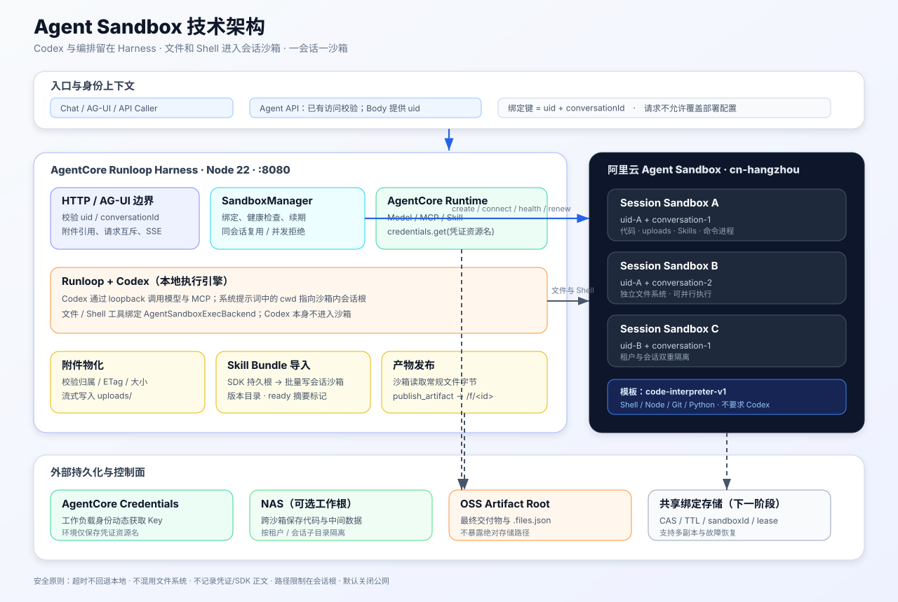
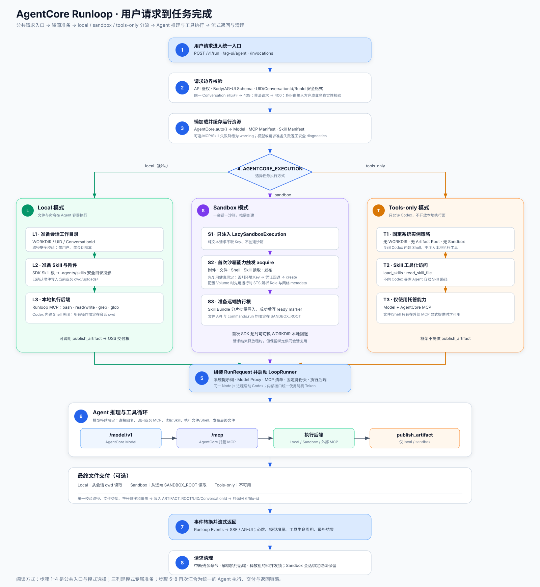
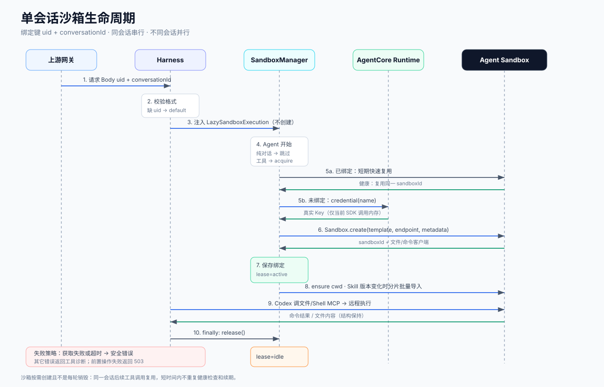
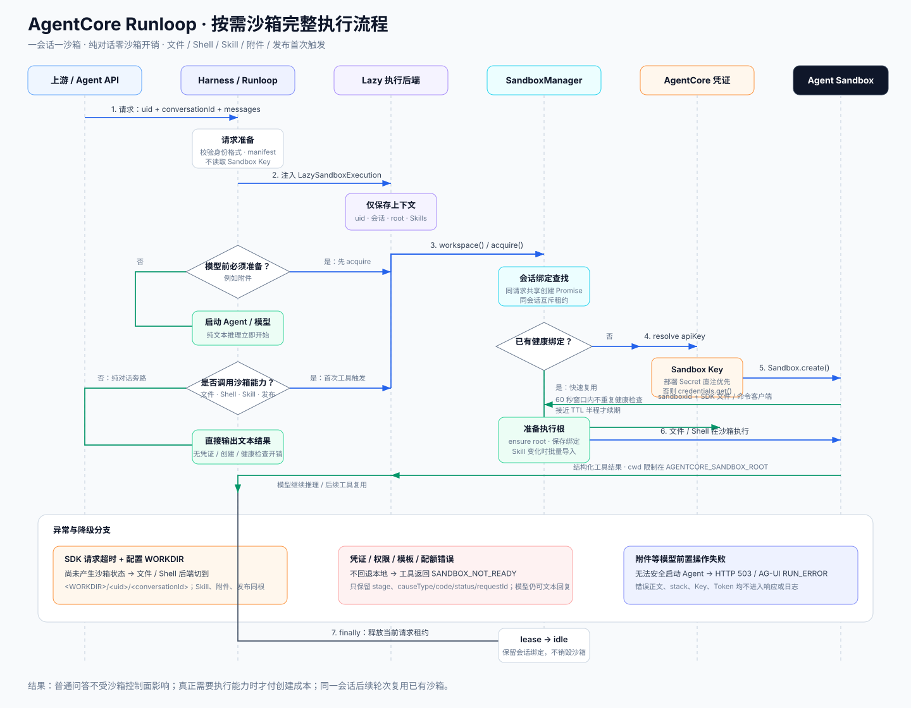
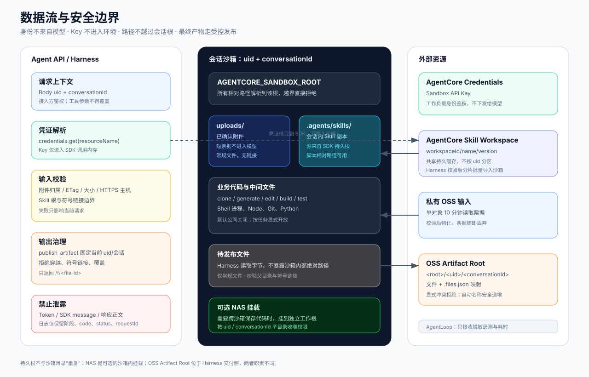
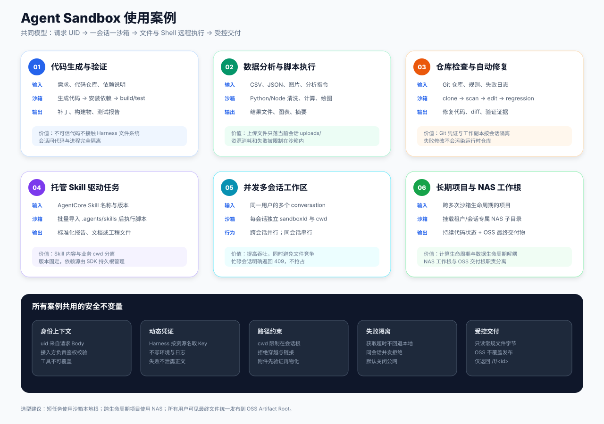

# Agent Sandbox 技术架构

本方案将 AgentCore Runloop 的文件与命令执行面迁移到阿里云 Agent Sandbox，实现“一会话一沙箱”。Codex、模型代理、MCP 聚合与业务编排继续运行在 Harness 内；沙箱只保存会话代码/文件并执行 Shell，不需要安装 Codex。

## 架构视图



## 用户请求主流程



该图从一个用户请求入口开始，先展示鉴权、参数校验和 Model/MCP/Skill 资源准备，再分别展开 `local`、`sandbox`、`tools-only` 三种执行方式，最后汇合到统一的 LoopRunner、Agent 推理循环、产物发布、SSE/AG-UI 返回与请求清理流程。建议将其作为本目录的主阅读入口，再结合后续沙箱生命周期和安全边界图查看实现细节。

核心边界：

- `/v1/run` Body 提供 `uid`，AG-UI 使用 `forwardedProps.uid`，未提供时为 `default`；接入方负责业务鉴权和 UID 真实性，`uid + conversationId` 组成沙箱绑定键。
- 请求开始只注入惰性执行后端；纯文本对话不取 Sandbox Key、不创建沙箱，首次附件、文件/Shell、Skill 读取或发布操作才获取会话沙箱。
- 同一会话复用一个健康沙箱，不同会话可并行；同一会话并发请求返回 `409`。
- Harness 优先使用部署 Secret 注入的 `AGENTCORE_SANDBOX_API_KEY`；未配置时才使用 AgentCore 工作负载身份按凭证资源名动态获取 Key。真实 Key 不进入请求、模型上下文或日志。
- 文件与 Shell MCP 使用远程执行后端，路径被限制在 `AGENTCORE_SANDBOX_ROOT`。
- 托管 Skill 从 SDK 系统级缓存按不可变版本批量导入当前会话沙箱，完成后写入摘要标记；已校验附件被物化到同一执行根，最终文件通过 `publish_artifact` 发布到 OSS 交付根。
- 首次沙箱操作发生 SDK 请求超时且配置了 `AGENTCORE_WORKDIR` 时，尚未产生沙箱状态的执行后端切换到 Agent 容器会话目录；非超时配置/凭证/配额错误和同会话繁忙不回退。
- 获取失败记录安全的 `sandbox_acquire_failed` 日志，包含阶段、异常类型及 SDK 可用的 code/status/requestId，不记录异常正文、stack、响应正文或凭证。

## 生命周期



## 完整执行流程



这张图覆盖纯对话旁路、附件前置准备、首次工具惰性创建、凭证动态获取、同会话快速复用、Skill 同步、超时本地回退以及安全错误返回。

当前绑定和互斥租约保存在单进程内存中，适用于单副本或上游按 `uid + conversationId` 粘性路由。多副本需要将绑定、租约 owner/expiry 与回收状态迁移到支持 CAS/TTL 的共享存储，并使用 SDK `connect()` 恢复沙箱。

## 数据与安全边界



Sandbox 本地目录只保证沙箱生命周期内存在。如果代码需要跨沙箱保留，应把 NAS 挂载到沙箱内独立目录，再将 `AGENTCORE_SANDBOX_ROOT` 指向该挂载点；交付物仍通过 `publish_artifact` 进入独立 OSS 发布根。

## 使用案例



## 部署配置

Sandbox Key 支持两种部署方式：可通过部署 Secret 直接注入 `AGENTCORE_SANDBOX_API_KEY`；未注入时，Harness 默认在首次沙箱操作读取名为 `AGENT_SANDBOX_API_KEY` 的 AgentCore 凭证，只有使用其他凭证名称时才需要覆盖 `AGENTCORE_SANDBOX_CREDENTIAL`：

```env
AGENTCORE_EXECUTION=sandbox
AGENTCORE_SANDBOX_API_KEY=<通过部署 Secret 注入，可选>
AGENTCORE_SANDBOX_CREDENTIAL=AGENT_SANDBOX_API_KEY
AGENTCORE_SANDBOX_API_URL=https://api.cn-hangzhou.sandbox.aliyuncs.com
AGENTCORE_SANDBOX_DOMAIN=cn-hangzhou.sandbox.aliyuncs.com
AGENTCORE_SANDBOX_TEMPLATE=code-interpreter-v1
AGENTCORE_SANDBOX_VOLUME_NAME=agent-sandbox-nas
AGENTCORE_SANDBOX_VOLUME_MOUNT_PATH=/mnt/sandbox
AGENTCORE_SANDBOX_ROOT=/mnt/sandbox
AGENTCORE_SANDBOX_ALLOW_INTERNET=false
```

`code-interpreter-v1` 的 `/workspace` 在实测中不可写。未挂载 Volume 时推荐 `/tmp/agentcore-work`；挂载 NAS Volume 时工作根使用实际挂载目录，例如 `/mnt/sandbox`。

## 已验证能力

- 杭州默认 Endpoint 与默认域名可用，无需自定义域名。
- 沙箱创建、健康检查、Shell 执行、SDK 文件读写、清理与主动回收均通过。
- 内置模板具备 Node、Git、Python；沙箱侧无需 Codex。
- 自动化测试覆盖惰性创建、同会话复用、Skill 分片批量导入与失败标记、安全诊断和超时本地回退。
