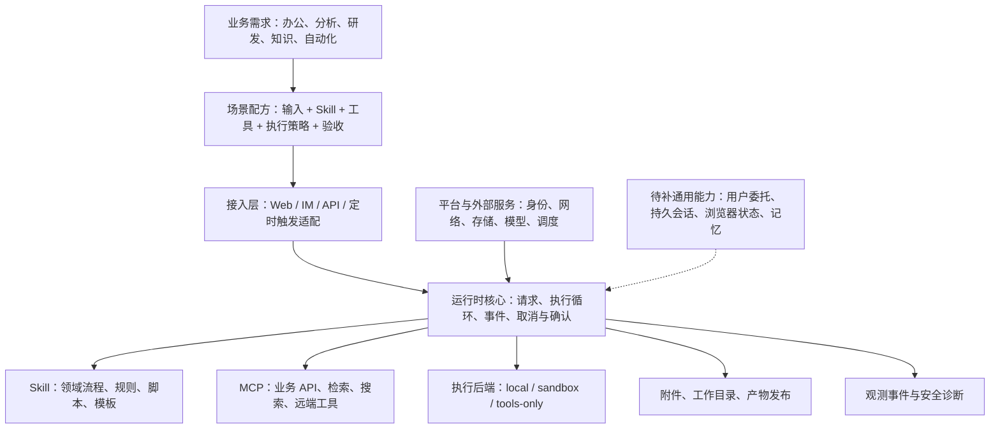
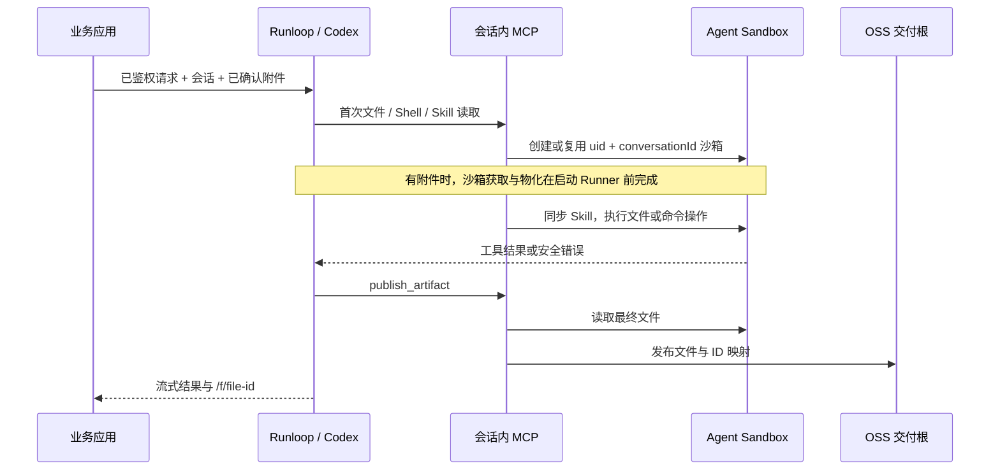
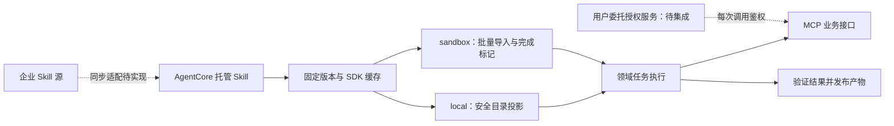

# 场景方案：从业务需求到通用运行时能力

[返回首页](../../README.md) · [能力目录](capabilities.md) · [配置参考](../reference.md)

AgentCore Runloop 的定位是**可通过 Skill、MCP 和执行后端扩展的通用 Agent 运行时框架**。当前以 Codex 为执行内核、AgentCore 为资源与部署基础；“通用”指业务场景可组合，不代表已经支持任意 Agent 内核或任意云平台。

新增场景应先寻找可复用的能力组合：业务方法封装成 Skill，业务系统接入 MCP，文件与命令交给执行后端，身份、会话、交付和观测保持统一契约。只有多种场景共同需要、且现有组合无法表达的能力才进入框架核心。

## 分层与扩展边界



图中的 IM、定时触发与虚线部分是扩展方向；目前内置接入为 HTTP / AG-UI / SSE。现状与差距以[能力目录](capabilities.md)为准。

## 可组合的场景方案

下表是能力组合方案。依赖服务、Skill 包、模板及权限必须在目标环境验证。

| 场景 | 需求与执行流程 | 能力组合 | 当前落地条件 |
| --- | --- | --- | --- |
| 远程代码与脚本执行 | 提交任务/附件 → 获取会话沙箱 → 执行 Shell、Node 或模板中的 Python → 返回结果 | C01 + C02 + C05 | 已有 E2B SDK 对接阿里云 Agent Sandbox；模板负责语言运行时与依赖 |
| 挂载企业 Skill 的专业助手 | 绑定固定版本 Skill → 读取说明、规则和模板 → 执行脚本 → 交付 | C03 + C02 + C05 | local 使用 SDK 根目录投影，sandbox 批量物化；企业 Skill 源同步需另接控制面 |
| 运营数据分析与报告 | 读取已确认附件 → 计算与校验 → 生成报告/结果表 → 发布文件 | C03 + C05 + C02 | 可组合现有能力；表格、绘图等依赖由 Skill 或沙箱模板提供 |
| 企业知识与业务查询 | 查询有权限的数据 → 检索与引用 → 按业务规则回答 | C04 + C08 + C06 | MCP 接口可复用；知识库与用户级授权由接入服务实现 |
| 办公协作与内部系统操作 | 查询文档/任务 → 草拟变更 → 用户确认 → 调用业务 API | C04 + C06 + C07 + C11 | MCP 与确认机制已有基础；个人 OAuth/SSO、IM 适配及业务幂等仍需集成 |
| 联网研究与信息整理 | 搜索 → 获取网页 → 提取来源 → 汇总报告 | C04 + C08 + C05 | 搜索/抓取需绑定 MCP；未内置通用搜索服务、计费或配额管理 |
| 浏览器自动化 | 获取个人或团队浏览器环境 → 登录态绑定 → 页面操作 → 输出证据 | C02 + C06 + C09 | 需要 Browser MCP/SDK 适配及登录态治理；Shell 沙箱本身不等于浏览器能力 |
| 代码检查与批量文件处理 | 读取代码/材料 → 按 Skill 检查或转换 → 验证 → 发布 | C02 + C03 + C05 | 可组合现有能力；联网拉取仓库需 MCP 或允许联网的远端沙箱 |
| 会话工作台与问题定位 | 列出历史会话 → 展示消息、资源、文件与执行轨迹 → 定位失败 | C10 + C05 + C12 | 事件与产物发布已有；持久会话查询、资源快照及面向用户的工作台待补 |
| 周期性分析与巡检 | 调度触发 → 校验授权仍有效 → 执行查询/分析 → 保存或通知 | C06 + C13 + C12 | 外部调度器可调用 HTTP；调度授权、去重、重试和通知适配需补齐 |
| 多 Agent 协作 | 发现专业 Agent → 委派任务 → 关联子轨迹 → 汇总结果 | C14 + C12 + C06 | vendored 内核有委派代码，但当前应用未形成 A2A 服务、注册发现和级联观测闭环 |

## 配方 A：远程沙箱执行

适用于代码执行、数据处理、依赖隔离和需要独立工具环境的任务。服务容器运行 Harness、Codex 和模型/MCP 代理；远端沙箱运行文件与 Shell 操作。服务容器自身的隔离由部署平台提供。



最小执行段示例（还需模型连接等基础配置）：

```env
AGENTCORE_EXECUTION=sandbox
AGENTCORE_SANDBOX_API_URL=https://api.<region>.sandbox.aliyuncs.com
AGENTCORE_SANDBOX_DOMAIN=<region>.sandbox.aliyuncs.com
AGENTCORE_SANDBOX_TEMPLATE=<已验证的模板名称或ID>
AGENTCORE_SANDBOX_ROOT=/tmp/agentcore-work
AGENTCORE_SANDBOX_CREDENTIAL=AGENT_SANDBOX_API_KEY
AGENTCORE_SANDBOX_ALLOW_INTERNET=false
AGENTCORE_SKILLS=<Skill名称>@<固定版本>
AGENTCORE_ARTIFACT_ROOT=<服务容器内独立OSS交付挂载根>
```

凭证资源需预先配置；占位值不能直接部署。服务使用 `e2b` Node SDK，但当前 Provider、凭证与 Volume 集成都面向阿里云 Agent Sandbox，不宣称兼容所有 E2B 服务商。

验收至少覆盖：纯文本不创建沙箱；首次操作创建；同会话复用；不同用户/会话隔离；Skill 完整导入；取消命令；沙箱超时不回退本地；最终文件可由应用鉴权读取。当前租约仅在单进程内，多副本共享租约和恢复需补齐；共享 Volume 必须验证命名空间，不能因“一会话一沙箱”就推断共享目录天然隔离。

参见[沙箱架构](../sandbox/README.md)与[实现限制](../reference.md#执行隔离local--sandbox)。

## 配方 B：企业 Skill + 业务工具

Skill 描述“如何完成任务”，MCP 提供“能够访问哪些系统”。运行时负责加载、隔离、调用、事件和交付。



业务规则、报表模板、数据字典、调用顺序和校验脚本放入 Skill 包；业务域名、账号体系与知识库实现放在资源配置或连接器中。框架不硬编码业务标识、内网域名或用户 Token。

“Skill 挂载”不意味着两种执行模式使用相同机制，也不意味着自动安装所有依赖。SDK 缓存可共享不可变内容；个人凭证、浏览器 Cookie 和用户数据不得放进共享 Skill 包。

## 配方 C：企业助手的完整交付链

一次用户任务可同时需要知识检索、Skill、沙箱和文件交付。落地时应验证整条链，而非只验证模型能回答：

1. 应用完成入站鉴权，绑定真实用户和会话；不能信任模型工具参数中的身份。
2. 运行时准备固定的模型/MCP/Skill 配置；可选资源失败返回降级信息。
3. MCP 按用户权限查询数据；需要用户委托的接口必须经过单独的出站授权服务。
4. Skill 组织处理步骤，在所选执行后端计算、校验并生成文件。
5. 业务写操作按策略确认并记录结果；重试需要下游幂等保障。
6. `publish_artifact` 返回文件 ID，应用文件服务负责按用户/会话鉴权访问。
7. 保存会话、资源版本和执行结果，关联观测轨迹，为定位和评测提供证据。

第 3 步的用户委托，以及第 7 步完整的持久会话服务仍是待补能力，不能由工作负载身份或现有观测日志替代。

## 新场景的沉淀模板

每个场景至少记录以下内容，再决定是否需要改运行时：

| 项目 | 应回答的问题 |
| --- | --- |
| 用户目标与输入 | 用户要完成什么，输入是消息、附件还是业务对象？ |
| 能力组合 | 复用哪些 Cxx 能力，需要新增哪一个通用契约？ |
| 身份与授权 | 谁发起、代表谁执行、可访问什么、谁确认写操作？ |
| 执行与数据 | local / sandbox / tools-only，工作文件和交付物分别放在哪里？ |
| 扩展归属 | Skill、MCP、接入适配、运行时核心还是部署平台？ |
| 生命周期 | 超时、取消、重试、会话恢复、凭证过期如何处理？ |
| 可观测与验收 | 输出什么证据，成功、失败、越权和降级分别如何判定？ |
| 当前状态 | 已实现、组合接入、待开发、平台依赖；是否有目标环境 E2E 证据？ |

业务流程优先表达为 Skill、MCP 和执行后端的组合；跨场景共用的缺口再沉淀为通用运行时能力。
